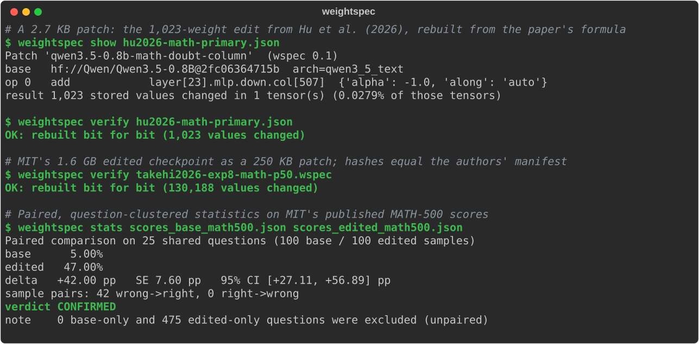

<div align="center">

# WeightSpec

**The open standard and runtime for weight-space programming.**

Describe an edit to a neural network's weights as a small, readable, verifiable patch.<br>
Apply it to any compatible checkpoint. Rebuild it bit for bit. Measure it honestly.

[](https://github.com/namashworks/weightspec/actions/workflows/ci.yml)
[](https://pypi.org/project/weightspec/)
[](https://pypi.org/project/weightspec/)
[](LICENSE)
[](spec/RFC-0001-patch-format.md)
[](https://colab.research.google.com/github/namashworks/weightspec/blob/main/notebooks/quickstart.ipynb)
[](https://huggingface.co/spaces/weightspec/weightspec)

</div>

<p align="center"></p>

---

In November 2026, frontier LLMs were shown to **read and rewrite another model's weights directly**, with no gradient descent: one edit to **1,023 numbers** took Qwen3.5-0.8B from 8.35% to 37.80% on held-out MATH-500 ([Hu et al.](https://arxiv.org/abs/2611.09382), building on [Takehi et al.](https://rikiyat.github.io/blog/weight-space-programming/)). Within a week, dozens of repos appeared, each with its own way to store an edit, name a weight, and count "changed parameters". Their results can't be exchanged or checked against each other.

WeightSpec is the missing common layer. Here is that 1,023-value edit as a complete, rebuildable patch:

```python
import weightspec as ws

qwen = ws.load("Qwen/Qwen3.5-0.8B")          # lazy: fetches only the tensors it needs (~8 MB here)

doubt    = ws.readout(qwen, ["Wait", "However", "But", "Maybe", "Perhaps"])
progress = ws.readout(qwen, ["Therefore", "Thus", "So", "Now", "The", "First", "Next", "Let"])

patch = ws.Patch.new(qwen, "math-doubt-column").add(
    "layer[23].mlp.down.col[507]",            # MLP unit 507's write direction
    (doubt - progress).normalize(),
    alpha=-1.0,
)
patch.build(policy=ws.Policy.paper())         # 1,023 stored values changed, exactly as the paper reports
patch.save("math-doubt-column.json")          # 2.7 KB, human-readable, includes hashes
```

Anyone can check it, no GPU needed:

```console
$ weightspec verify math-doubt-column.json
OK: rebuilt bit for bit (1,023 values changed)
```

## Install

```bash
pip install weightspec                 # core: numpy + pydantic only
pip install "weightspec[agent]"        # + probes (torch, transformers) and LLM editors
pip install "weightspec[all]"          # everything, including the MCP server and Hub upload
```

No install needed to try it: run the [**Colab notebook**](https://colab.research.google.com/github/namashworks/weightspec/blob/main/notebooks/quickstart.ipynb) (CPU, about a minute) or open the [**Space**](https://huggingface.co/spaces/weightspec/weightspec).

## Verified against the original authors

WeightSpec reproduces the published edits from public checkpoints. These checks run in CI ([`conformance/`](conformance/)):

| Reference patch | What it is | Size | Check |
|---|---|---|---|
| [`hu2026-math-primary.json`](conformance/hu2026-math-primary.json) | Hu et al. (2026), Eq. 3, rebuilt from the published formula | 2.7 KB | 1,023 changed values, as reported in the paper |
| [`takehi2026-exp8-math-p50.wspec`](conformance/takehi2026-exp8-math-p50.wspec) | MIT's edited Qwen3.5-0.8B (Exp. 8), extracted with `weightspec diff` | 250 KB (vs a 1.6 GB checkpoint) | **Base and edited SHA-256 equal the authors' own manifest** |

`weightspec` can also explain an edit from the weights alone. MIT's edit turns out to be one operation per layer, `project_scale` with k = 6: in 64 MLP units each of layers 15 and 19, the component along one direction is multiplied by −5 ([`examples/explain_takehi_exp8.py`](examples/explain_takehi_exp8.py)).

## What you get

| | |
|---|---|
| **A patch format** ([RFC-0001](spec/RFC-0001-patch-format.md), [JSON Schema](spec/schema/patch-0.1.schema.json)) | A JSON manifest plus optional safetensors payloads. It stores *recipes* ("readout of these tokens, normalized") instead of opaque tensors whenever possible. |
| **Portable selectors** | `layer[15].attn.head[7].out`, `layer[19].attn.head[11].gate`, `final_norm`. Resolved per architecture (Llama, Qwen, Gemma, Mistral, gated-query Qwen3.5 / Qwen3-Next, …), with `tensor['…']` as an escape hatch for any network. |
| **Six typed ops** | `add`, `scale`, `set`, `rank1`, `project_scale`, `delta`. Together they cover every edit published so far. |
| **Direction algebra** | `readout`, `embedding`, `weights`, `vector`, `+ − ×`, `.normalize()`, `.project_off([...])`, `.random_orthogonal(seed)` |
| **Exact numerics** | float32 compute, one round-to-nearest-even cast to the storage dtype (bit-identical to PyTorch), changed values counted bit for bit. |
| **Bit-for-bit verification** | Base and result SHA-256 for every tensor touched. `verify` rebuilds from the base and compares. |
| **Policy enforced in code** | `Policy.paper()` freezes embeddings, LM head and final norm and refuses whole-tensor rescaling. Limits on changed values. Non-finite results rejected. |
| **Automatic controls** | `ws.controls(patch)` creates dose sweeps, a reversed direction, equal-norm random orthogonal directions and an ablation: the evidence the paper used. |
| **Paired statistics** | `weightspec stats base.jsonl edited.jsonl`: question-clustered paired difference, SE, 95% CI, rescues/regressions, verdict. |
| **Works anywhere** | Hugging Face Hub (HTTP range reads, no full download), local safetensors, numpy dicts, or a live `torch.nn.Module` edited in place. Windows, macOS, Linux. |

## Command line

```bash
weightspec inspect Qwen/Qwen3.5-0.8B                      # architecture map: heads, gated queries, full-attention layers
weightspec resolve Qwen/Qwen3.5-0.8B "layer[15].attn.head[7].out"
weightspec build my-edit.json --policy paper              # apply a hand-written draft, record hashes
weightspec verify my-edit.json                            # rebuild from the base and check bit for bit
weightspec apply my-edit.json --out ./edited-model        # write a complete edited checkpoint
weightspec diff base/ edited/ --out edit.wspec            # turn any two checkpoints into a patch
weightspec stats base_scores.jsonl edited_scores.jsonl    # paired comparison with a confidence interval
weightspec schema                                         # the JSON Schema of the format
```

On MIT's published MATH-500 samples ([RikiyaT/Qwen3.5-0.8B-weight-space-programming](https://huggingface.co/RikiyaT/Qwen3.5-0.8B-weight-space-programming)):

```console
$ weightspec stats eval/scores_base_math500.json eval/scores_edited_math500.json
Paired comparison on 25 shared questions (100 base / 100 edited samples)
  base      5.00%
  edited   47.00%
  delta   +42.00 pp   SE 7.60 pp   95% CI [+27.11, +56.89] pp
  sample pairs: 42 wrong->right, 0 right->wrong
  verdict CONFIRMED
  note    0 base-only and 475 edited-only questions were excluded (unpaired)
```

## The format at a glance

```jsonc
{
  "wspec": "0.1",
  "name": "math-doubt-column",
  "base": { "source": "hf://Qwen/Qwen3.5-0.8B", "revision": "2fc0636…", "arch": "qwen3_5_text",
            "tensors": { "model.language_model.layers.23.mlp.down_proj.weight": "<sha256 before>" } },
  "ops": [{
    "op": "add", "target": "layer[23].mlp.down.col[507]", "alpha": -1.0,
    "u": { "fn": "normalize", "of": { "fn": "sum", "coefs": [1, -1], "terms": [
      { "fn": "readout", "tokens": ["Wait", "However", "But", "Maybe", "Perhaps"], "ids": [13784, 10883, …] },
      { "fn": "readout", "tokens": ["Therefore", "Thus", …], "ids": [52971, …] } ] } }
  }],
  "result": { "changed": 1023, "tensors": { "…down_proj.weight": { "changed": 1023, "sha256": "<after>" } } },
  "provenance": { "editor": "agent:GPT-6 Astra", "access_level": "weights+50fwd", "cites": ["arXiv:2611.09382"] }
}
```

## Use it with your own model

```python
import torch, weightspec as ws
from transformers import AutoModelForCausalLM

model = AutoModelForCausalLM.from_pretrained("Qwen/Qwen3-0.6B", torch_dtype=torch.bfloat16)
store = ws.load(model)                                   # or ws.load("path/to/checkpoint")

patch = (ws.Patch.new(store, "quiet-head")
         .scale("layer[10].attn.head[3].out", 0.5)        # halve one head's output
         .zero("layer[12].mlp.down.col[42]"))             # ablate one MLP unit
ws.apply(model, patch)                                   # edits the live model in place
patch.build(store); patch.save("quiet-head.json")        # share it: 1 KB
```

It is not limited to language models: any `torch.nn.Module` or safetensors file works through `tensor['name']` selectors, including RL policies, CNNs and diffusion MLPs.

## Share an edit like a model

```python
patch.push_to_hub("you/qwen-patches")                    # -> hf://you/qwen-patches/quiet-head.json
ws.Patch.load("hf://you/qwen-patches/quiet-head.json").verify()
```

```bash
weightspec verify hf://you/qwen-patches/quiet-head.json   # anyone, anywhere, no GPU
```

## Probe the model: forward passes under a budget

The scarce resource in weight-space programming is forward passes. A `Probe` loads the model once and keeps it at its original weights. For an edited request it swaps in only the edited tensors, then restores them, even if the request crashes. Every successful request is charged to a budget.

```python
probe = ws.Probe.from_pretrained("Qwen/Qwen3.5-0.8B", budget=50, device="cuda")
probe.set_patch(patch)

res = probe.generate(["What is 17 * 23?"], weights="both", n=4, max_new_tokens=2048)   # paired: same seeds
tf  = probe.teacher_forced(["... 391.\n\nWait"], weights="edited", mlp_layers=[23], hidden_layers=[15])
probe.budget.status()   # {'used': 2, 'limit': 50, 'remaining': 48}
```

Two teacher-forced requests are enough to check *how* the 1,023-value edit works ([`examples/probe_doubt_tokens.py`](examples/probe_doubt_tokens.py), CPU). At the start of a new reasoning paragraph, the edited Qwen3.5-0.8B puts far less probability on doubt tokens ("Wait", "But", "However", "Hmm"), for example 0.205 → 0.0001, and the doubt-to-progress odds fall about 200-fold. That is the mechanism Hu et al. describe, measured directly. It used three prompts, so it checks the mechanism, not accuracy.

## Evaluate honestly: paired, held out, with controls

```python
report = ws.evaluate(probe, patch, ws.load_items("math500.jsonl"), grader="math", n=4,
                     controls=ws.controls(patch))       # dose sweep, reversed, random directions, ablation
print(report)          # paired delta with 95% CI, truncation per arm, and whether the edit beats every control
```

Graders: `math` (last `\boxed{}`, numeric equivalence), `exact`, `contains`, `choice`, `numeric` (5% relative tolerance), or any function.

## Let an LLM do weight-space programming

A `Session` gives an editor LLM the tools, the budget and the rules, then gets out of the way. It checkpoints after every step and can resume after a crash. It logs every call to `trajectory.jsonl`. Once the editor commits to a final choice, it evaluates that choice on a **sealed holdout** the editor never saw.

```bash
pip install "weightspec[agent]"
weightspec run Qwen/Qwen3.5-0.8B --goal "Improve accuracy on competition math" \
    --dev math_train.jsonl --holdout math500.jsonl --budget 50 --device cuda \
    --editor anthropic:claude-opus-5-5          # or openai:<model>@http://localhost:8000/v1 for a local model
```

```python
session = ws.Session(probe=probe, editor="anthropic:claude-opus-5-5", goal="Improve accuracy on competition math",
                     dev=ws.load_items("math_train.jsonl"), holdout=ws.load_items("math500.jsonl"),
                     workspace="runs/math-1")
result = session.run()          # -> final.json / final.wspec, holdout.json, trajectory.jsonl, result.txt
```

Editors: Claude through the Anthropic SDK (default `claude-opus-5-5`; adaptive thinking, prompt caching, refusal fallbacks), any OpenAI-compatible server (vLLM, Ollama, OpenRouter, OpenAI), or a scripted editor for tests and exact replays. Keeping the original weights is a valid outcome, as in the papers.

## Or bring your own agent (MCP)

WeightSpec ships an [MCP](https://modelcontextprotocol.io) server with the same toolkit, so Claude Code, Codex, Cursor or any MCP client can do weight-space programming. The agent never runs code inside the server. It writes ops as JSON, every edit passes through the policy, every forward pass is charged to the budget, and every write stays inside the workspace.

```bash
pip install "weightspec[mcp]"
claude mcp add weightspec -- weightspec mcp --workspace ./wsp-work                       # weight tools
claude mcp add weightspec -- weightspec mcp --workspace ./wsp-work \
    --probe Qwen/Qwen3.5-0.8B --dev math_train.jsonl --budget 50 --device cuda           # + forward passes
```

Weight tools: `inspect_model`, `resolve_selector`, `tensor_stats`, `readout_tokens`, `op_schema`, `create_patch`, `add_op`, `build_patch`, `make_controls`, `save_patch`, `load_patch`, `verify_patch`, `diff_models`, `paired_stats`, `list_patches`. With `--probe`, forward-pass tools are added: `budget_status`, `list_items`, `generate`, `teacher_forced`, `contrast_activations` (saves activation differences as named vectors to use as edit directions), and `evaluate_patch`. A `weight_space_edit` prompt guides the agent through diagnose → localize → edit → control → confirm.

For example, an agent asking `readout_tokens` what Qwen3.5-0.8B's MLP unit 507 (layer 23) writes finds that it mostly *suppresses* " let / Let / 让我们" ("let's"). That is the unit the 1,023-value edit rewires.

## Status and roadmap

WeightSpec is **alpha** (v0.1). The format is a draft RFC and we want feedback on it.

- [x] Patch format, JSON Schema, RFC-0001 draft
- [x] Selectors, ops, direction algebra, exact numerics, policy, verification
- [x] Hub range reads, local, numpy and PyTorch backends; `diff`; controls; paired statistics; CLI
- [x] Conformance suite reproducing the two reference papers
- [x] MCP server for coding agents; Hub sharing (`push_to_hub`, `hf://` loading); Colab notebook; Space
- [x] **Probes:** generation and teacher-forced requests with a forward-pass budget and in-place weight hot-swap (transformers)
- [x] **Evaluation:** paired held-out comparison with graders and automatic controls
- [x] **Agent sessions:** checkpointed, resumable editor loop with Claude, OpenAI-compatible or scripted editors; sealed holdout
- [ ] vLLM / SGLang backends for fast probes on large models
- [ ] Importers for other WSP harnesses' formats
- [ ] Quantized checkpoints (FP8, GPTQ/AWQ, GGUF)
- [ ] More reference edits in the conformance suite

## Honest limitations

Weight-space programming is days old and contested. The published gains mostly come from **repairing a failure**: Qwen3.5-0.8B looped until it hit the token limit 93% of the time. They do not come from adding knowledge. Independent replications vary widely, and Hu et al. found that 6 of 16 editing runs kept the original weights. WeightSpec takes no side. It makes edits exact, comparable and checkable, so the field can find out what holds.

Weight edits are dual-use: the same tools that repair a model can remove safety behavior. See [SECURITY.md](SECURITY.md).

## Contributing

The most valuable contributions right now:

1. **Feedback on [RFC-0001](spec/RFC-0001-patch-format.md)**, especially from authors of other WSP tools. A standard only works if it is shared.
2. **Architecture maps** for more model families (good first issues).
3. **Reference patches** reproducing published edits, for the conformance suite.

See [CONTRIBUTING.md](CONTRIBUTING.md). Development setup:

```bash
git clone https://github.com/namashworks/weightspec && cd weightspec
uv venv && uv pip install -e ".[dev]"
pytest              # offline, CPU-only, a few seconds
pytest -m network   # conformance against the real Hugging Face checkpoints
```

## Citation

```bibtex
@software{weightspec2026,
  title  = {WeightSpec: An Open Standard and Runtime for Weight-Space Programming},
  year   = {2026},
  url    = {https://github.com/namashworks/weightspec}
}
```

Please also cite the work that defined the field: Takehi, Teoh, Zhang and Khattab, *Sparks of Weight-Space Programming* (MIT CSAIL, 2026), and Hu et al., *Exploring Weight-Space Programming* (arXiv:2611.09382).

## License

Apache-2.0. Reference patches in `conformance/` describe edits published by their respective authors and are credited in each patch's `provenance`.
